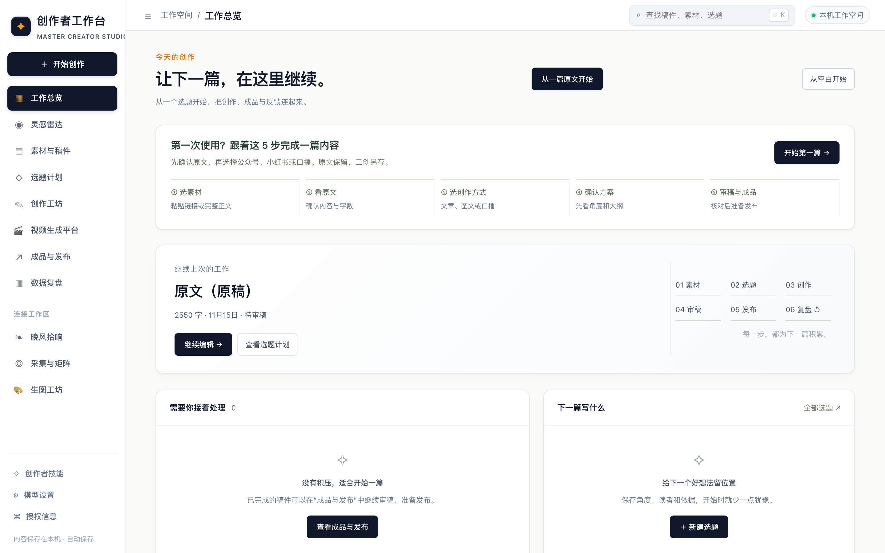
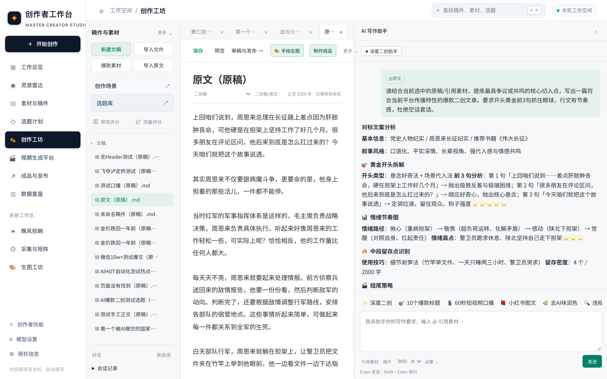
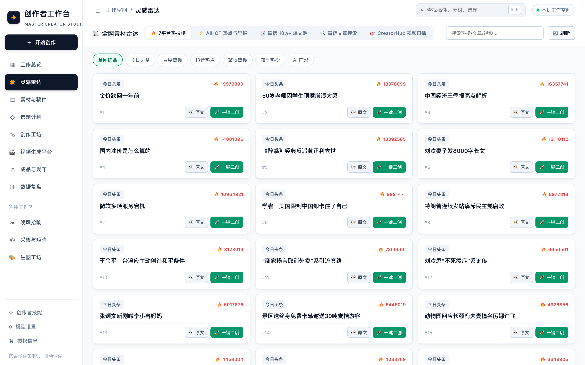
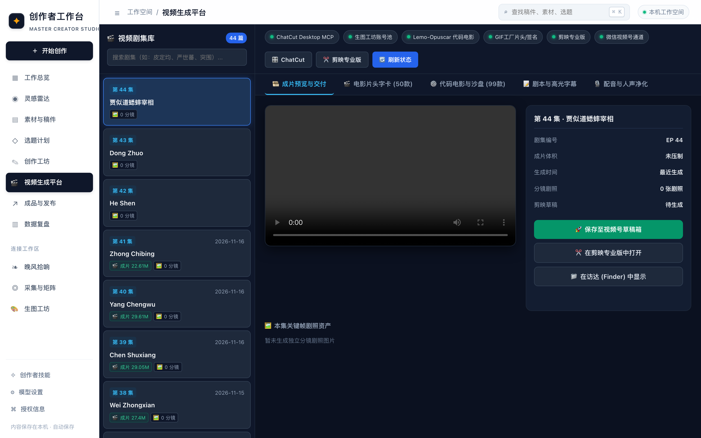

# 创作者统合工作台 · Master Creator Studio

> 专注于深度长文、商业爆款、短剧脚本与多模态内容资产的一站式工业化创作者生产力平台。

---

## 📸 界面预览（Interface Showcase）

### 1. 工作总览 · 创作闭环全生命周期看板
> 从选素材、看原文、确定方案、大纲拟定到审稿发布，一目了然的创作链路。



### 2. 创作工坊 · 三栏极简沉浸式生产台
> 左侧资产与多格式素材库，中央无干扰长文排版编辑，右侧集成 AI 深度拆解、受众情绪图谱与黄金开头分析。



### 3. 灵感雷达 · 全网爆款与热点采集
> 聚合主流 7 大平台实时热搜榜、AI 行业前沿资讯，一键发起定向二创流。



### 4. 生图工坊 · 视觉信息图与风格卡片
> 内置手绘微缩、Bento Grid 便当盒、Minimalist 与 370+ 风格预设，一键生成小红书 3:4 与公众号配图。


### 5. 视频生成平台 · 短剧与多模态剧集工厂
> 联动 ChatCut Desktop MCP 与剪映专业版，涵盖 50+ 电影片头字卡、代码电影沙盘与多集剧照资产流。



---

## 🌟 核心功能特性

### 1. ✍️ 沉浸式创作工坊（Creative Workbench）
- **专业长文与小说编辑**：支持纯粹无干扰的沉浸式 Markdown 写作、大纲目录树、实时字数与阅读时长统计。
- **历史版本与双栏对照**：每次关键生成、改写或润色均支持独立版本切片与实时差异对照（Diff）。
- **引用来源与二创管道**：自动管理参考资料、外部导入稿件及二创草稿，引用源与正文一键联通。

### 2. 📡 灵感雷达与热点采集（Inspiration Radar）
- **实时资讯中枢**：集成 AIHOT、全网热度雷达与主流平台爆款热榜，实时捕捉各垂直赛道讨论风向。
- **跨平台定向二创**：一键将热点资讯、行业动态转化为微信公众号推文、小红书图文卡片、知乎深度解答或短视频口播文案。
- **生态无缝互联**：内置专用接收通道，与 **CreatorHub（多平台采集与分发矩阵）** 深度互通，点击即可将短视频口播逐字稿秒级推入文案工坊。

### 3. 🎨 生图工坊与视觉卡片（Visual Studio）
- **多版式图文排版**：支持便当盒 Bento Grid、金句海报、大字报卡片及小红书 3:4 竖版多图流排版。
- **风格提示词引擎**：内置丰富的手绘、拟真与艺术插画提示词库，支持局部重绘与风格化渲染。

### 4. 🎬 视频生成平台（Video Studio）
- **短剧与漫剧工业化工作流**：支持从一句话点子自动拓展为剧情大纲、分集剧本与分镜头导演脚本（Storyboard）。
- **提示词与媒体调度**：支持 Seedance 2.5 规格的镜头机位、运镜方式、角色外观一致性锁定与分镜资产导出。

### 5. 💎 Google Labs Stitch 设计规范（Anti-AI-Slop）
- **护眼与克制美学**：严格贯彻 Google Labs Stitch `taste-design` 标准，摒弃刺眼高饱和度霓虹与杂色荧光，采用经过色彩学标定的 **Radix Slate/Zinc** 中性基底与 **Studio Amber（琥珀工匠金）** 单一点缀色。
- **触觉级微交互**：全面引入物理阻尼回弹曲线 `cubic-bezier(0.16, 1, 0.3, 1)`，长时间创作不视觉疲劳。

---

## 🚀 快速启动指南

### 环境要求
- Python 3.10+
- 现代浏览器（Chrome、Edge、Safari 或内置桌面 WebKit Shell）

### 安装依赖
```bash
pip install -r requirements.txt
# 或安装核心服务依赖：
pip install fastapi uvicorn pydantic httpx
```

### 启动服务
```bash
# 启动本地创作工作台服务（默认运行在 8788 端口）
python server.py --port 8788

# 或通过 shell 脚本启动：
./start.sh
```

打开浏览器访问：`http://127.0.0.1:8788/web/index.html` 即可进入工作台。

---

## 📁 目录架构概览

```text
├── server.py                 # FastAPI 核心主服务路由与静态文件托管
├── workspace_imports.py      # CreatorHub 跨应用导入通讯接口与数据管道
├── radar_service.py          # 灵感雷达与外部热点抓取服务
├── creative_workflows.py     # 长文改写、大纲拓展与多风格写作引擎
├── video_studio_service.py   # 视频分镜与短剧工业流调度引擎
├── media_planner.py          # 多模态媒体分发与配图规划
├── doc_engine.py             # 文档版本追踪与持久化解析
├── web/                      # 现代化前端界面（HTML5 / CSS3 / ES6）
│   ├── index.html            # 工作台前端单页主应用
│   ├── studio-shell.css      # Stitch 规范设计底座与响应式侧边栏
│   ├── studio-tokens.css     # 设计令牌与色彩系统定义
│   ├── shell.js              # 前端交互与路由调度
│   └── features/             # 各独立功能子模块（生图、视频、选题等）
├── config/                   # 内置技能配置与行业赛道预设
└── tests/                    # 单元与集成测试套件
```

---

## 📄 开源许可证

本项目基于 [MIT License](LICENSE) 开源发布。
